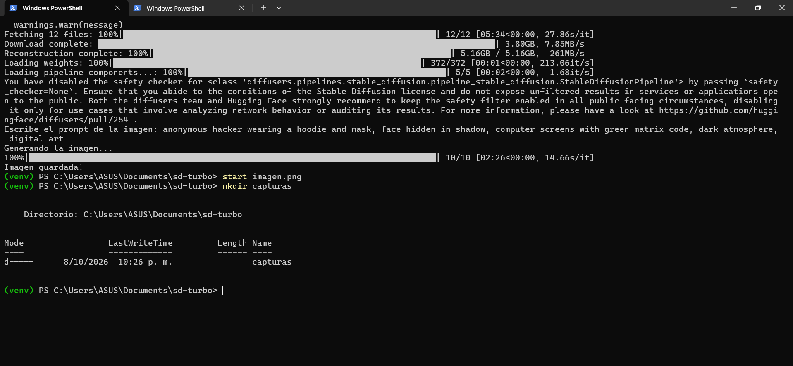

# Generación de imágenes con SD-Turbo

Script en Python que genera una imagen a partir de un prompt de texto usando el modelo stabilityai/sd-turbo con la librería diffusers. Se ejecutó en CPU (gráfica AMD Radeon).

## Ejecución

## Imagen generada
Prompt: anonymous hacker wearing a hoodie and mask, face hidden in shadow, computer screens with green matrix code, dark atmosphere, digital art

## Imagen abierta

